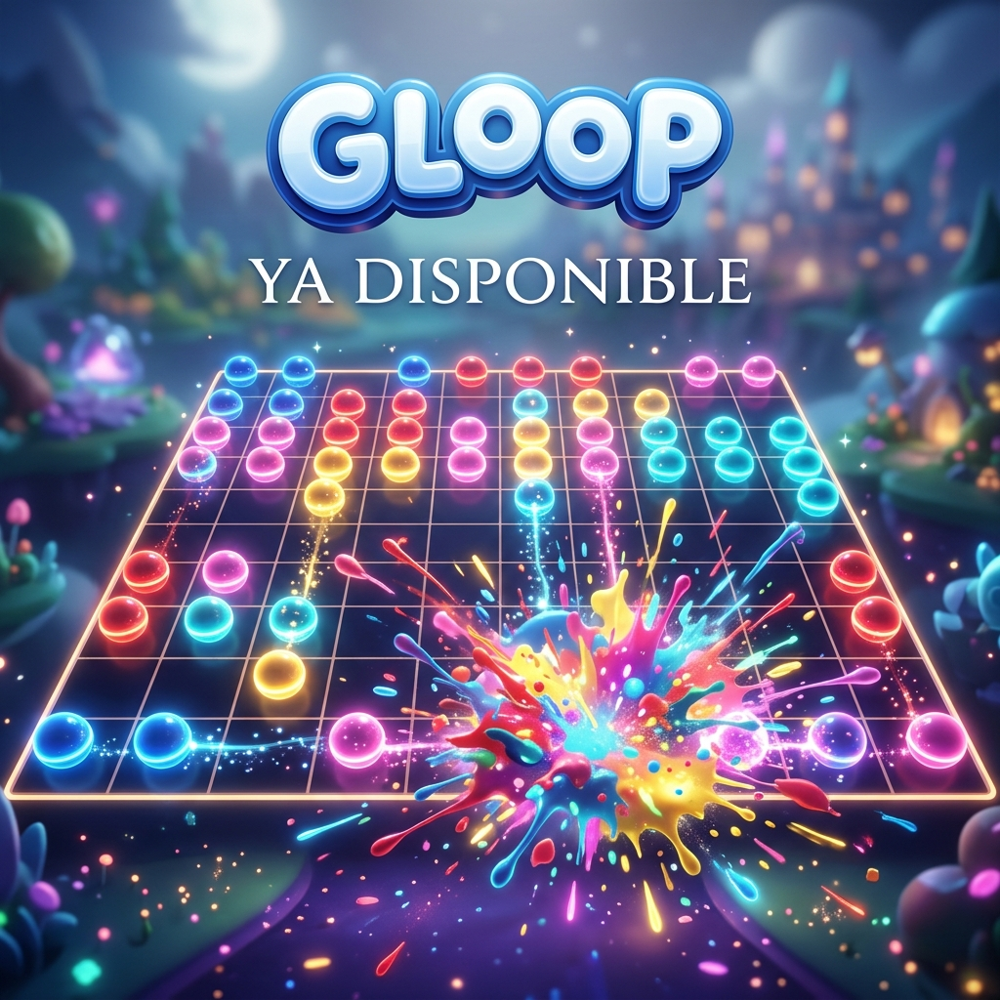

# Gloop

[](https://github.com/lautisen/bolitas-game/actions/workflows/ci.yml)
[](https://github.com/lautisen/bolitas-game/actions/workflows/deploy.yml)

**[Play in the browser](https://lautisen.github.io/bolitas-game/)** · **[Get it on Google Play](https://play.google.com/store/apps/details?id=com.dreaminraw.bolitas)**

A cross-platform mobile puzzle game built with vanilla JavaScript, Vite and Capacitor, released on Android and playable on the web.

Tap groups of three or more same-coloured blobs to pop them. Gravity pulls the remaining blobs down, empty columns collapse sideways, and every level asks you to hit a score target before you run out of moves. Progression is endless: levels are generated procedurally across ten themed biomes, with difficulty rising in waves and a boss level at the end of each block of fifteen.



## Highlights

- **Procedural level generation.** Board size, colour count and score target are derived from the level number. Targets are calculated from board density (cells per colour) so every level is beatable, and the generator re-rolls boards that start with too few valid moves.
- **Game feel.** Combo multipliers, an idle hint after five seconds, a four-star rating system, synthesized sound effects (Web Audio, no sample files) and animated biome unlocks.
- **Meta progression.** Coins, XP and player levels, five purchasable boosters (bomb, colour bomb, sniper, shuffle, magic brush), 100 daily quest templates and 20 weekly ones, a login calendar, a daily spin and an activity streak.
- **Native mobile integration** through Capacitor 8: local notifications for retention, Android back-button handling across stacked overlays, safe-area insets injected from native code, and a native splash screen.
- **Live operations.** Firebase Analytics for funnel events, Crashlytics for crash reporting, and Remote Config to force updates when a minimum version is required.
- **Monetization done responsibly.** AdMob banner, interstitial and rewarded ads behind a UMP consent flow, with frequency caps and child-directed treatment enabled.
- **Localization** in four languages (English, Spanish, French, German) with a script-verified key parity across all of them.

## Tech stack

| Area | Tools |
| :--- | :--- |
| Game and UI | Vanilla JavaScript (ES modules), HTML, CSS. No UI framework. |
| Build | Vite 7, javascript-obfuscator for production builds (added as an experiment to learn how obfuscation affects bundle size and runtime behaviour; the readable source is all in this repo) |
| Testing | Vitest with jsdom |
| Mobile | Capacitor 8 (Android, iOS project scaffolded) |
| Backend services | Firebase Analytics, Crashlytics, Remote Config |
| Ads | AdMob via `@capacitor-community/admob` |
| CI/CD | GitHub Actions runs the tests on every push and pull request, then builds and deploys the web version to GitHub Pages |

## Project structure

| Path | Contents |
| :--- | :--- |
| `src/main.js` | Game loop, rendering, boosters, ads and screen flow |
| `src/board.js` | Pure board logic: flood-fill groups, gravity, column collapse, move detection, spawn colours |
| `src/scoring.js` | Points per pop, combo multipliers and star thresholds |
| `src/biomes.js` | Procedural level generation and difficulty curve |
| `src/economy.js` | Coins, XP and the daily and weekly quest system |
| `src/shop.js`, `src/dailySpin.js`, `src/dailyCalendar.js` | Shop and retention features |
| `src/audio.js` | Sound effects synthesized with the Web Audio API |
| `src/translations.js` | i18n strings for four languages |
| `src/analyticsManager.js`, `src/versionCheck.js` | Firebase Analytics wrapper and forced-update check |
| `android/`, `ios/` | Native Capacitor projects |
| `public/` | Static assets: biome art, icons, music, web manifest |
| `docs/` | Detailed technical documentation and roadmap (in Spanish) |

## Running locally

Requires Node.js 20 or newer.

```bash
npm install
npm run dev      # start the Vite dev server
npm test         # run the test suite
npm run build    # production build in dist/
npx cap sync     # copy the web build into the native projects
```

Open `android/` in Android Studio to build the Android app.

## Tests

The suite in `tests/` covers the parts of the game that are pure logic:

- **Level generation** (`biomes.test.js`): every generated level across 100 biome blocks has a valid grid size, colour count and a score target rounded to 50; the first biome stays gentle; every later biome ends with a boss level; booster tutorial levels are forced easy.
- **Lives** (`livesManager.test.js`): consumption, timed regeneration with fake timers, the maximum cap and persistence across reloads.
- **Localization** (`translations.test.js`): all four languages have the same keys and the same `{{placeholders}}` as English, with no empty strings.

## Documentation

- [docs/CODEBASE.md](docs/CODEBASE.md) is a full technical walkthrough of every module, the data model and the main flows.
- [docs/ROADMAP.md](docs/ROADMAP.md) lists audit findings, fixes and planned work.

Both are written in Spanish.

## Note on public identifiers

The Firebase configuration (`android/app/google-services.json`) and the AdMob app and ad unit IDs in the source are client-side identifiers that ship inside every copy of the app. They are not secrets; access to the Firebase project is controlled by security rules (Firestore is fully locked down) and API key restrictions.

## License

All rights reserved; the source is published for portfolio purposes. See [LICENSE](LICENSE). The bundled Outfit font is licensed under the [SIL Open Font License](public/assets/fonts/OFL.txt).
